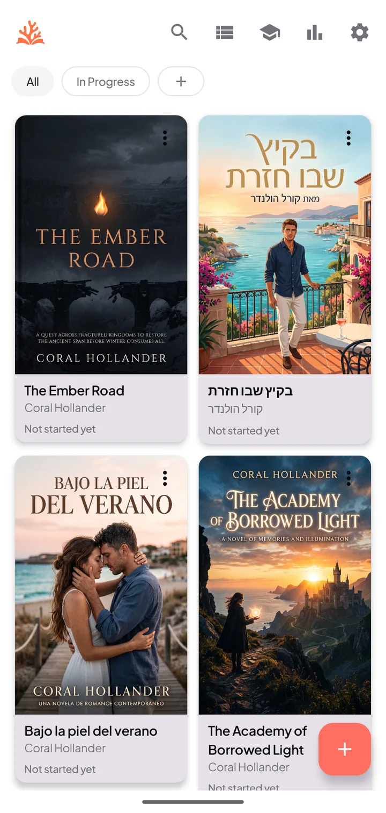
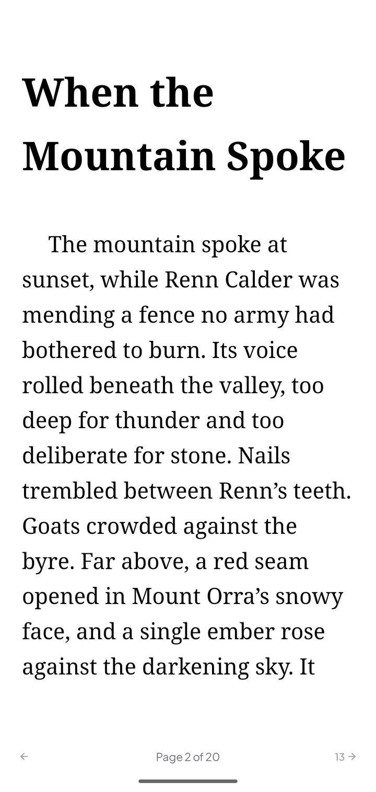
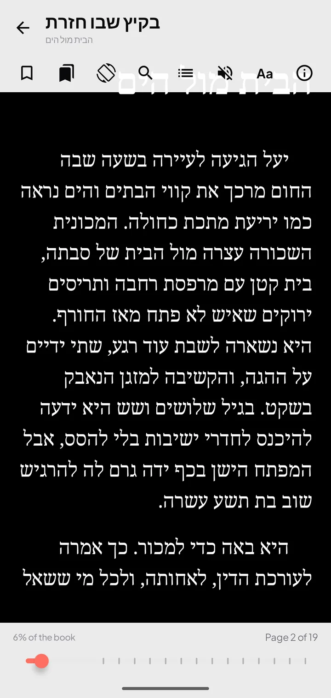
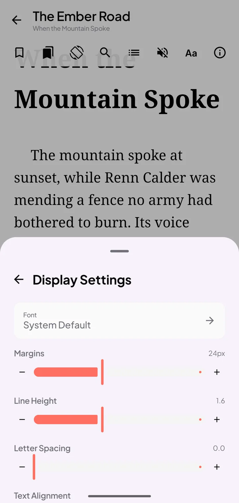
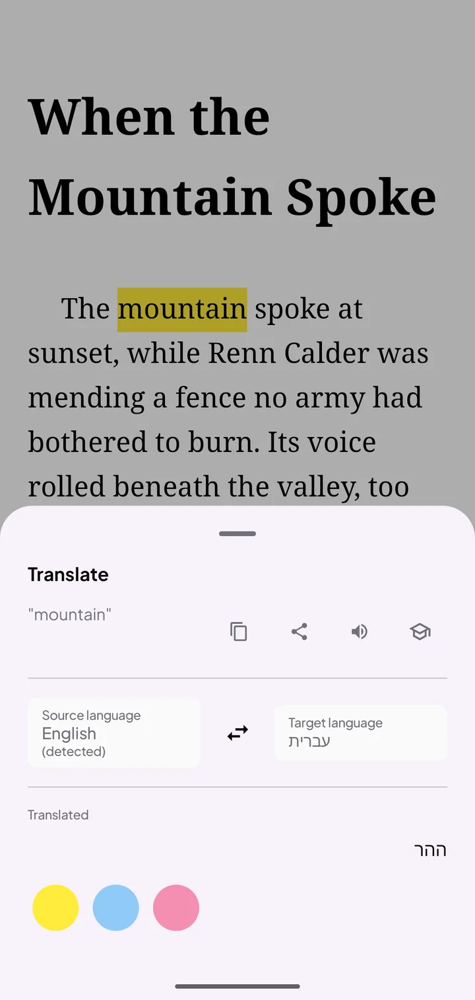
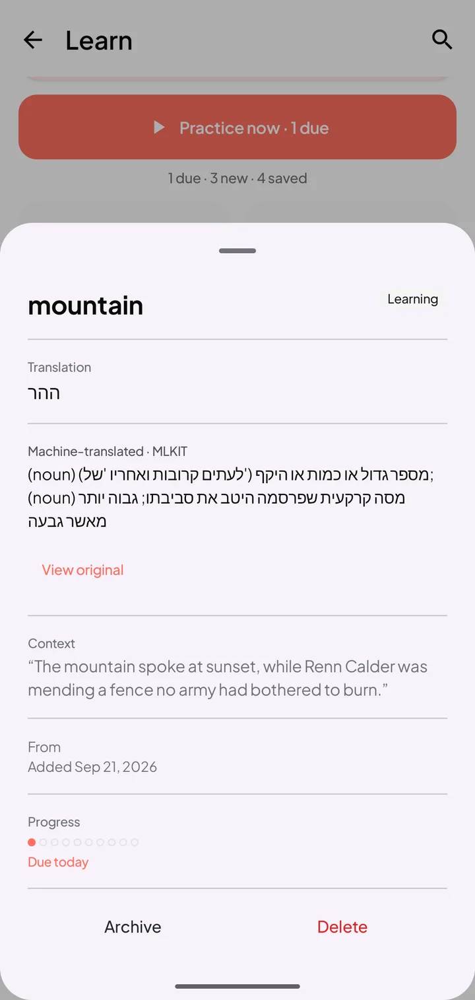
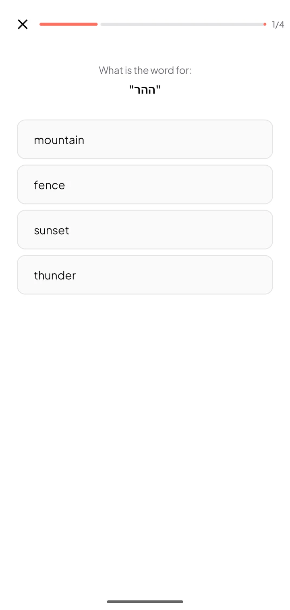
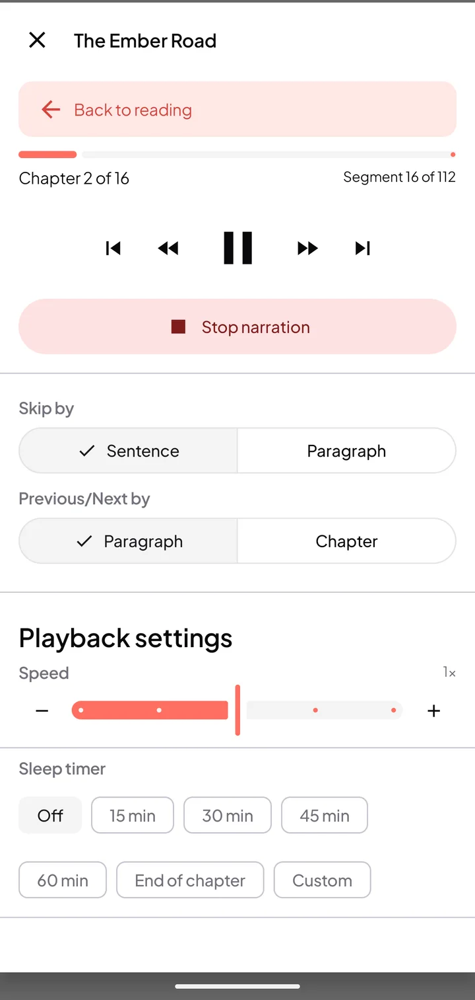

<div align="center">


# Coral Reader

### Read what you love. Learn as you go.

**A private, beautifully customizable reader for EPUB, PDF and more, with on-device translation, vocabulary and Read Aloud. Built for Android and iOS.**

🌐 **Website:** https://amih90.github.io/coral-reader/

[](#-download)
[](#-download)
[](#-overview)

</div>

---

## 📖 Overview

**Coral Reader** turns your phone and tablet into a personal library. Import your
own **EPUB, PDF, Markdown, text, HTML, FB2, DOCX, and ODT** documents, and read
them with a clean, paginated, fully customizable experience — then pick up right
where you left off.

Whether you're settling in with a novel, working through a textbook, or reviewing
a PDF report, Coral Reader keeps the focus on the words. No clutter, no noise —
just comfortable, elegant reading.

> **Many formats, one reader.** Coral Reader converts supported documents into a
> consistent, reflowable reading experience, so your library feels at home in one app.

---

## 📸 App Preview

Real screens from Coral Reader 1.10.2 on Android (the library holds original sample books).

<div align="center">

| | | | |
| :---: | :---: | :---: | :---: |
|  |  |  |  |
| **Your library** | **Page by page, like a book** | **Light, sepia or dark · right-to-left** | **Read exactly your way** |
|  |  |  |  |
| **Long-press. Translate.** | **Every word keeps its sentence** | **Practice offline** | **Or just listen (Coral Pro)** |

</div>

---

## 📱 Available on Android & iOS

Coral Reader is built with **Kotlin Multiplatform** and **Compose Multiplatform**,
delivering a true **native** experience on both platforms from a single shared
codebase. The same polished reading experience, whether you're on an iPhone, iPad,
or any Android phone or tablet.

| Android | iOS |
| :---: | :---: |
| Phones & Tablets | iPhone & iPad |

---

## ✨ Features

- 📚 **Broad Format Support** — Read EPUB, PDF, Markdown, text, HTML, FB2, DOCX, and ODT in one place.
- 🗂️ **Categories & Library Filters** — Create categories, add a book to more than one, and filter alongside All, In Progress, and Finished.
- 🔊 **Read Aloud** — Listen with on-device voices, synchronized highlighting, automatic page follow, background playback, and voice and speed controls.
- 🌐 **Offline Translation** — Translate selected English and Hebrew text in place with downloaded on-device models. Book text never goes to a translation server.
- 📂 **Library Management** — Import, search, organize, and browse your collection in grid or list view with rich cover art.
- 📄 **Flexible Page Turning** — Choose tap, swipe, or both, with paginated reading and direction-aware navigation.
- 🎨 **Reading Customization** — Choose from bundled fonts and fine-tune font size, margins, line height, letter spacing, text alignment, brightness, and color themes.
- ✍️ **Highlights, Notes & Footnotes** — Mark passages, save thoughts, and open footnotes without losing your place.
- 📊 **Progress & Reading Stats** — Track position, chapters, time, pages, finished books, and reading streaks.
- 🌙 **Light, Dark & System Themes** — Read comfortably day or night.
- 🌍 **Localization** — Full English and Hebrew support, including right-to-left (RTL) layout.
- 🔒 **Rotation Lock** — Lock screen orientation while you read.
- 💎 **Coral Pro** — Unlock the full experience with a flexible subscription (monthly, yearly, or lifetime).
- 🔐 **Privacy-First** — Your books stay on your device.

---

## 🎯 Main Highlights

| | |
| --- | --- |
| **One app, many formats** | Read books and documents without switching apps. |
| **Read or listen** | Continue with on-device narration and background playback. |
| **Understand in place** | Translate English and Hebrew selections offline. |
| **Your library, organized** | Create categories that match the way you collect books. |
| **Truly cross-platform** | Native Android & iOS from a shared codebase. |
| **Made for comfort** | Fonts, themes, spacing, and margins tuned to you. |
| **Never lose your place** | Reliable per-book progress tracking. |
| **Reads your language** | English & Hebrew with full RTL support. |

---

## 🚀 Download

Coral Reader is available on the **[App Store](https://apps.apple.com/us/app/coral-reader/id6782911744)** and **[Google Play](https://play.google.com/store/apps/details?id=dev.hollander.coralreader&pcampaignid=web_share)**.

---

## Launch campaign links

Reuse each platform's link across its text, image, or video posts. These links
open the homepage, use the **launch** campaign, and pass platform and channel
labels to the stores, not individual post identifiers. Once the website and
collection service changes are deployed, store-button clicks are also counted
independently as described below.

| Platform / placement | Homepage link |
| --- | --- |
| WhatsApp messages / groups | https://coral-reader.com/?utm_source=whatsapp&utm_campaign=launch |
| Instagram paid ads | https://coral-reader.com/?utm_source=instagram&utm_medium=paid_social&utm_campaign=launch |
| Instagram unpaid posts / bio | https://coral-reader.com/?utm_source=instagram&utm_medium=organic_social&utm_campaign=launch |
| Facebook unpaid posts | https://coral-reader.com/?utm_source=facebook&utm_medium=organic_social&utm_campaign=launch |
| Reddit unpaid posts | https://coral-reader.com/?utm_source=reddit&utm_medium=organic_social&utm_campaign=launch |

To open the dedicated download page instead, replace `/?` with `/get/?` and
keep the same parameters.

Only `utm_source` and `utm_campaign` are required. An omitted `utm_medium`
defaults to `referral`; set it explicitly for other channels (for example,
`organic_social` or `paid_social`). An omitted Apple `ct` is generated as
`<utm_campaign>_<utm_source>`, so the WhatsApp link above still reports as
`launch_whatsapp`. Existing fully specified links continue to work unchanged.
Use `organic_social` for unpaid social posts and `paid_social` for paid social
ads. For paid Facebook or Reddit ads, replace `organic_social` in the example
with `paid_social`.

Android results appear in Mixpanel under `install_attribution_resolved`, grouped
by `acquisition_source` and filtered to `acquisition_campaign = launch`.
iOS results appear in App Store Connect > Analytics > Acquisition > Campaigns
under `launch_whatsapp`, `launch_reddit`, `launch_facebook`, or `launch_instagram`.
Paid and unpaid links for the same platform share the default Apple campaign
label; set explicit distinct `ct` values to separate them in App Store Connect.
Apple reports aggregate results only after its minimum qualifying-download
threshold is met; TestFlight installs do not validate these campaigns.
Forwarded links retain their original platform label.

### Controlled iOS verification link

Use this dedicated download-page link for a controlled, real-device check:

https://coral-reader.com/get/?utm_source=verification&utm_medium=referral&utm_campaign=verify_ios_nov&ct=verify_ios_nov

The explicit `ct` keeps the Apple campaign named exactly `verify_ios_nov`
(rather than the generated `verify_ios_nov_verification`). With the checked-in
provider configuration, the iOS button's expected destination is:

https://apps.apple.com/app/coral-reader/id6782911744?pt=129068563&ct=verify_ios_nov&mt=8

The configured public provider token `129068563` matches the campaign link
previously generated by App Store Connect.
The Android button retains the same UTM labels in its Play Install Referrer.
These are shared campaign labels, not identifiers for a person or device.
Preparing or inspecting the link does not verify an iPhone download, campaign
credit, or its appearance in Apple's reports. Do not generate synthetic clicks
or downloads; a real qualifying App Store download and Apple's reporting
threshold still apply.

### Outbound store-click measurement

The shared store-link module sends a best-effort form POST to the existing Coral
backend at
`https://coralreader-qvugf3wd-api.redgrass-94a370ab.swedencentral.azurecontainerapps.io/api/v1/acquisition/store-clicks`.
It covers only explicit App Store / Google Play buttons, including clicks on
their images and keyboard or middle-button activation, not generic navigation
to the download section/page. Page views do not send click events.

| Page | Placement | Platforms |
| --- | --- | --- |
| `/` | `hero`, `bottom` | `ios`, `android` |
| `/get/` | `download` | `ios`, `android` |

Each event contains `page`, `platform`, `placement`, and `attributed` (`true` or
`false`, based on the actual decorated store URL). Optional `utm_source`,
`utm_medium`, `utm_campaign`, `utm_content`, and `utm_term` are read from the
landing link only when each is a single valid label; invalid, duplicate, or
unknown parameters are omitted. An omitted medium is reported as `referral`
only when the store URL is attributed, matching the store-link default.
For attributed iOS links, `ct`, `pt`, and `mt` come from the final Apple URL,
including generated `ct` values, never an untrusted incoming provider token.
`utm_term` is a click-report field only; existing store URLs/referrers are
unchanged. Use shared, non-personal labels, never personal information.

The request uses `URLSearchParams`, `keepalive: true`, `credentials: "omit"`,
and `referrerPolicy: "no-referrer"`. There are no cookies, persistent visitor
identities, raw URLs, referrers, arbitrary query values, retries, or navigation
delays. Failed collection logs a concise warning without link data; downloads
still work. Counts represent clicks, not unique visitors, completed downloads,
or installs. Repeated clicks can count again, and disabled JavaScript, blockers,
network failures, or keepalive limits can cause undercounting. Ordinary hosting
network metadata is separate from the click payload; see the privacy policy.

This code is not live until deployed. Deploy the backend collector/CORS support
and its Grafana reporting before publishing these website changes. The collector
accepts the production origin `https://coral-reader.com` only, so localhost and
GitHub Pages preview origins do not collect production clicks. Browser checks
intercept all collection requests and do not send synthetic production events.
Publishing this static site requires the generated assets described below;
no mobile release is needed. This website repository does not provision the
backend or Grafana dashboards.

## Website development

GitHub Pages serves this repository's root at https://coral-reader.com.
The campaign download page source, Apple provider configuration, and tests live
in `download-page/`; its images and app logo live in `assets/`.

```sh
npm --prefix download-page ci
npm --prefix download-page run check
npm --prefix download-page run test:browser
```

The browser checks use installed Google Chrome. The build updates
`get/index.html`, its hashed CSS/JavaScript in `assets/`, and only the shared
store-link script reference in the homepage.
Commit those generated files alongside source changes; Pages does not run Node.
Keep old hashed assets available for cached pages.

`download-page/campaign-config.json` contains Apple's public provider token.
A nonempty `APP_STORE_PROVIDER_TOKEN` overrides it for a build.
Campaign labels use required `utm_source` and `utm_campaign`, optional
`utm_medium` (default `referral`), optional `utm_content`, and optional Apple's
`ct` (default `<utm_campaign>_<utm_source>`). Labels must be lowercase letters,
digits, underscores, or hyphens, start with a letter or digit, and contain at
most 50 characters. Apple `ct` has a 30-character limit, including generated
values; supply a shorter explicit `ct` if needed. Invalid or duplicate explicit
values are not replaced with defaults. Download-page tests are standalone and
do not require the private app repository.

The homepage accepts the same campaign parameters as `/get/`. Both its hero and
bottom download buttons forward validated labels to Google Play and the App
Store using the same link builder and configured Apple provider token. For
example: https://coral-reader.com/?utm_source=whatsapp&utm_campaign=launch
Missing required or invalid campaign labels leave downloads available without
attribution. An invalid Apple `ct` disables only Apple attribution. No cookies
or cross-visit campaign storage are used. No mobile app update is needed.

## 🎨 Branding

Looking for logos, colors, and brand assets? See the **[Branding Guide](BRANDING.md)**.

---

## 📜 Legal

- [Privacy Policy](legal/privacy-policy.html)
- [Terms of Use](legal/terms-of-use.html)
- [Support](legal/support.html)

---

<div align="center">


**Coral Reader** — Read what you love. Learn as you go.

</div>
